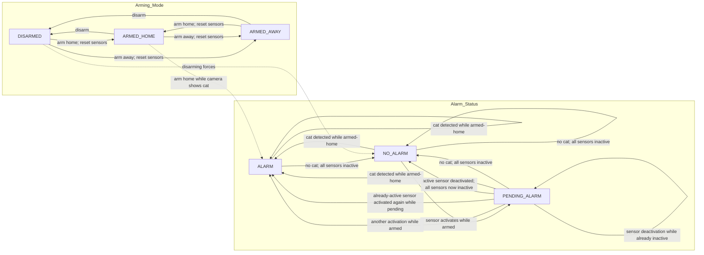

# Security system state machine

This diagram models the two independent state dimensions: the selected arming
mode and the alarm status. The complete system state is their pair. Alarm
transitions are conditioned on the current arming mode and sensor set.

An image scan with no cat leaves the alarm status unchanged when any sensor is
active. Arming resets every sensor to inactive. Disarming sets the alarm status
to `NO_ALARM`. The requirements specify the cat-triggered transition for
`ARMED_HOME`; they do not define a separate cat-scan transition for
`ARMED_AWAY`.

## Requirement-to-transition coverage

| Requirement | Transition represented |
|---|---|
| 1 | `NO_ALARM` to `PENDING_ALARM` on sensor activation while armed |
| 2 | `PENDING_ALARM` to `ALARM` on another activation while armed |
| 3 | `PENDING_ALARM` to `NO_ALARM` when an active sensor is deactivated and all sensors are inactive |
| 4 | Sensor state changes leave `ALARM` unchanged |
| 5 | Re-activating an already-active sensor while pending moves to `ALARM` |
| 6 | Deactivating an already-inactive sensor leaves the alarm status unchanged |
| 7 | Cat detected while armed-home moves to `ALARM` |
| 8 | No cat and no active sensors moves the status to `NO_ALARM` |
| 9 | Disarming forces `NO_ALARM` |
| 10 | Arming resets all sensors to inactive |
| 11 | Arming-home while a cat is visible sets the status to `ALARM` |

These transitions define the scenarios to exercise in `SecurityServiceTest`.
